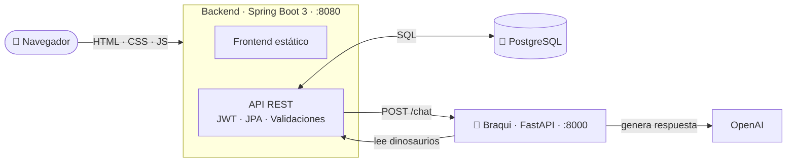

<div align="center">

# 🦕 DinoGlosario

**Un glosario web de dinosaurios con un asistente de inteligencia artificial que aprende de lo que te interesa.**


[¿Qué es?](#-qué-es) · [Funciones](#-qué-hace) · [Cómo arrancarlo](#-cómo-arrancarlo) · [Arquitectura](#-arquitectura) · [API](#-api-rest)

</div>

---

## 📖 ¿Qué es?

**DinoGlosario** es una aplicación web para consultar y gestionar un catálogo de dinosaurios descubiertos.

- 🧑‍🔬 Los **paleontólogos** (administradores) registran, editan y eliminan dinosaurios con sus características y fotos.
- 🧭 Los **exploradores** (usuarios) recorren el glosario, buscan, filtran y descubren nuevas especies.
- 🦕 **Braqui**, un braquiosaurio de caricatura que vive en la esquina de la pantalla, responde preguntas usando
  **IA + RAG** (recuperación de información) sobre los dinosaurios de la base de datos y una base de conocimiento propia.

## ✨ ¿Qué hace?

| | Función | Detalle |
|---|---|---|
| 🔎 | **Búsqueda y filtros** | Por nombre, periodo, dieta y grupo. 29 dinosaurios de ejemplo incluidos. |
| 🤖 | **Asistente Braqui** | Responde en contexto según la página que estás viendo, recomienda dinosaurios como tarjetas dentro del chat y muestra sus fuentes. |
| 🎯 | **Recomendaciones personalizadas** | «Elegidos para ti» y «Te puede interesar», calculados a partir de las fichas que abres, tus búsquedas y la conversación. Funciona sin cuenta y se puede borrar con *Olvidar mis intereses*. |
| 🧊 | **Modelo 3D interactivo** | Generado con Three.js según el grupo anatómico (cuernos, placas, vela, cresta…), animado y con una persona de 1,75 m a escala. Admite modelos `.glb` propios. |
| 🔊 | **Sonidos y música** | Rugidos y bramidos recreados con Web Audio según el tamaño, y música de fondo original generada en el navegador. |
| 🖼️ | **Imágenes reales** | Fotos y resúmenes de Wikipedia / Wikimedia Commons (con autor y licencia) cuando no hay fotos propias. |
| 🔐 | **Cuentas y roles** | Registro e inicio de sesión con JWT; los paleontólogos necesitan un código de acreditación. |
| ✅ | **Validaciones dobles** | En el navegador (respuesta inmediata) y en el servidor (la fuente de verdad), con mensajes en español junto a cada campo. |

## 🚀 Cómo arrancarlo

Hay dos formas: **con Docker** (lo más rápido) o **en local** (para desarrollar).

### Opción A · Con Docker 🐳

Solo necesitas [Docker Desktop](https://www.docker.com/products/docker-desktop/). PostgreSQL ya viene incluido.

```bash
cp .env.example .env        # en Windows: copy .env.example .env
# edita .env y pon tu OPENAI_API_KEY
docker compose up --build
```

Abre 👉 **http://localhost:8080**

### Opción B · En local 💻

#### Requisitos

| Herramienta | Versión |
|---|---|
| Java (JDK) | 21 |
| Maven | 3.9 o superior |
| Python | 3.11 o superior |
| PostgreSQL | 18 (probado) |

#### 1️⃣ Base de datos (PostgreSQL)

Ejecuta [`database/postgres/01_crear_base_datos.sql`](database/postgres/01_crear_base_datos.sql) conectado como
`postgres` (con Navicat, pgAdmin o `psql`). Crea el usuario `dino` / `dino123` y la base `dinoglosario`.

```bash
psql -U postgres -f database/postgres/01_crear_base_datos.sql
```

> [!NOTE]
> No hace falta crear las tablas: el backend las crea al arrancar por primera vez y carga los 29 dinosaurios
> y las cuentas de demostración. En [`02_consultas_utiles.sql`](database/postgres/02_consultas_utiles.sql)
> tienes consultas para explorarlas.

<details>
<summary>Paso a paso con Navicat</summary>

1. **Conexión → PostgreSQL**: host `localhost`, puerto `5432`, base `postgres`, usuario `postgres` y la
   contraseña que pusiste al instalar PostgreSQL.
2. Clic derecho en la base `postgres` → **Nueva consulta**, pega el contenido de `01_crear_base_datos.sql` y pulsa **Ejecutar**.
3. (Opcional) Crea una segunda conexión con el usuario `dino` para ver la base `dinoglosario` (esquema `public`).

</details>

#### 2️⃣ Backend Spring Boot (puerto 8080)

```bash
cd backend
mvn spring-boot:run
```

#### 3️⃣ Asistente Braqui en Python (puerto 8000)

En otra terminal:

```bash
cd rag-service
python -m venv .venv
.venv\Scripts\activate             # macOS/Linux: source .venv/bin/activate
pip install -r requirements.txt
copy .env.example .env              # macOS/Linux: cp .env.example .env
# edita .env y pon tu OPENAI_API_KEY → https://platform.openai.com/api-keys
uvicorn main:app --port 8000
```

#### 4️⃣ ¡Listo!

Abre 👉 **http://localhost:8080** y entra con una de las cuentas de demostración:

| Rol | Correo | Contraseña |
|---|---|---|
| 🧑‍🔬 Paleontólogo | `paleo@dinoglosario.com` | `Paleo2026` |
| 🧭 Usuario | `usuario@dinoglosario.com` | `Usuario2026` |

Código para registrar nuevos paleontólogos: `PALEO-2026`.

> [!TIP]
> **¿Sin PostgreSQL?** Arranca el backend con `SPRING_PROFILES_ACTIVE=h2` y usará una base H2 en archivo,
> sin instalar nada. También hay un perfil `mysql`.

> [!IMPORTANT]
> **Braqui sin IA:** si no hay `OPENAI_API_KEY`, o la cuenta de OpenAI no tiene saldo, Braqui funciona en
> **modo básico**: responde con el fragmento más relevante de la base de conocimiento, pero sin redactar con IA.
> Si el servicio Python está apagado, el backend responde con un mensaje amable en lugar de fallar.

> [!CAUTION]
> Pon tu clave de OpenAI solo en `.env`, que está en `.gitignore`. **Nunca** la escribas en `.env.example`,
> porque ese archivo sí se sube al repositorio.

### ⚙️ Variables de configuración

| Variable | Para qué sirve | Valor por defecto |
|---|---|---|
| `DB_URL` / `DB_USER` / `DB_PASSWORD` | Conexión a la base de datos | `jdbc:postgresql://localhost:5432/dinoglosario` · `dino` · `dino123` |
| `SPRING_PROFILES_ACTIVE` | Base de datos a usar: `postgres`, `h2` o `mysql` | `postgres` |
| `JWT_SECRET` | Secreto para firmar los tokens (mínimo 32 caracteres) | uno de ejemplo, **cámbialo en producción** |
| `CODIGO_PALEONTOLOGO` | Código de acreditación de paleontólogos | `PALEO-2026` |
| `ASISTENTE_URL` | Dirección del servicio de Braqui | `http://localhost:8000` |
| `OPENAI_API_KEY` | Clave de OpenAI | vacía → modo básico |
| `OPENAI_MODEL` | Modelo de OpenAI | `gpt-5-mini` |
| `OPENAI_MAX_TOKENS` | Máximo de tokens por respuesta | `12000` |
| `REINDEX_SEGUNDOS` | Cada cuántos segundos Braqui relee los dinosaurios | `60` |

## 🏗️ Arquitectura



<details>
<summary>📁 Estructura del proyecto</summary>

```
dinoglosario/
├── backend/                         Spring Boot (Java 21, Maven)
│   └── src/main/
│       ├── java/com/paleo/glosario/
│       │   ├── config/              Seguridad, recursos estáticos, datos de ejemplo
│       │   ├── controller/          REST: auth, dinosaurios, catálogos, archivos, asistente
│       │   ├── dto/                 Peticiones y respuestas con validaciones
│       │   ├── exception/           Errores en JSON y en español
│       │   ├── model/               Entidades JPA: Usuario, Dinosaurio, Característica, Imagen
│       │   ├── repository/          Spring Data JPA
│       │   ├── security/            JWT y filtro de autenticación
│       │   └── service/             Lógica de negocio
│       └── resources/
│           ├── static/              Frontend: index, dinosaurio, acceso, panel + css/js
│           └── application*.properties   Perfiles: postgres (por defecto), h2, mysql
├── rag-service/                     Asistente Braqui (Python, FastAPI)
│   ├── conocimiento/*.md            Base de conocimiento (edítala libremente)
│   ├── rag.py                       Indexado y búsqueda BM25
│   ├── llm.py                       Generación con OpenAI
│   ├── acciones.py                  Acciones que Braqui puede proponer en la página
│   └── main.py                      API: POST /chat, POST /reindex, GET /salud
├── database/postgres/               Scripts SQL
└── docker-compose.yml               PostgreSQL + backend + asistente
```

</details>

### 🦕 Cómo piensa Braqui (RAG)

1. **Indexa** los archivos `rag-service/conocimiento/*.md` (por secciones `##`) y todos los dinosaurios de la base
   de datos. Se refresca cada 60 s, o al instante con `POST /reindex`.
2. **Recupera** los 5 fragmentos más relevantes con BM25, con sinónimos y normalización del español.
3. **Genera** la respuesta con OpenAI y muestra las fuentes debajo de cada respuesta.

Para enseñarle algo nuevo basta con añadir o editar un `.md` en `rag-service/conocimiento/` y reiniciar el servicio.

## 🔌 API REST

<details>
<summary>Ver todos los endpoints</summary>

| Método | Ruta | Acceso | Descripción |
|---|---|---|---|
| `POST` | `/api/auth/registro` | Público | Crear cuenta (USUARIO, o PALEONTOLOGO con código) |
| `POST` | `/api/auth/login` | Público | Devuelve `{ token, usuario }` |
| `GET` | `/api/auth/me` | Autenticado | Datos del usuario actual |
| `GET` | `/api/dinosaurios?q=&periodo=&dieta=&grupo=` | Público | Listado con búsqueda y filtros |
| `GET` | `/api/dinosaurios/{id}` | Público | Ficha completa |
| `POST` | `/api/dinosaurios` | Paleontólogo | Crear |
| `PUT` | `/api/dinosaurios/{id}` | Paleontólogo | Editar |
| `DELETE` | `/api/dinosaurios/{id}` | Paleontólogo | Eliminar |
| `POST` | `/api/archivos/imagen` | Paleontólogo | Subir foto (multipart `archivo`) → `{ url }` |
| `GET` | `/api/catalogos/periodos` · `/dietas` · `/grupos` | Público | Valores para los selects |
| `POST` | `/api/asistente/chat` | Público | `{ mensaje, historial, contexto }` → `{ respuesta, fuentes, recomendaciones }` |
| `POST` | `/api/actividad` | Público | Registra `{ tipo, dinosaurioId, valor }` (VISTA, BUSQUEDA, FILTRO, SONIDO, MODELO3D…) |
| `GET` | `/api/recomendaciones?excluir=&limite=` | Público | Perfil de intereses + dinosaurios recomendados |
| `DELETE` | `/api/actividad` | Público | Olvidar los intereses de este usuario o navegador |

Autenticación con la cabecera `Authorization: Bearer <token>`. Los errores llegan como
`{ estado, error, mensaje, campos: { campo: "mensaje" } }`.

</details>

## 🛡️ Validaciones y seguridad

<details>
<summary>Ver el detalle</summary>

- **Registro:** nombre solo con letras (2–80), correo válido y único, contraseña de 8–64 caracteres con
  mayúscula, minúscula y número, y confirmación. Los paleontólogos también indican institución, especialidad
  y un código de acreditación válido.
- **Dinosaurio:** nombre único (2–80); nombre científico binomial (`Tyrannosaurus rex`); periodo y dieta
  obligatorios; longitud 0,1–60 m, altura 0,1–25 m, peso 0,001–100 t; año entre 1676 y el actual; altura
  coherente con la longitud; descripción de 30–4000 caracteres; hasta 30 características sin repetir y hasta 12 imágenes.
- **Imágenes:** solo JPG, PNG, WEBP o GIF de máximo 5 MB, comprobando la firma binaria del archivo (no solo la
  extensión) y guardándolas con un nombre aleatorio (UUID).
- **Seguridad:** contraseñas con BCrypt, JWT que caduca a las 8 h, rutas de escritura protegidas por rol y todo
  el texto escapado antes de insertarlo en el HTML (protección XSS).

</details>

## 🧪 Pruebas

```bash
cd backend
mvn test
```

Hay 10 pruebas de integración. Cubren los filtros, las validaciones, el código de acreditación, los permisos
por rol (401/403), el CRUD completo, el asistente con el servicio de IA apagado y las recomendaciones.

---

<div align="center">

Hecho con 🦴 y mucha curiosidad paleontológica.

</div>
